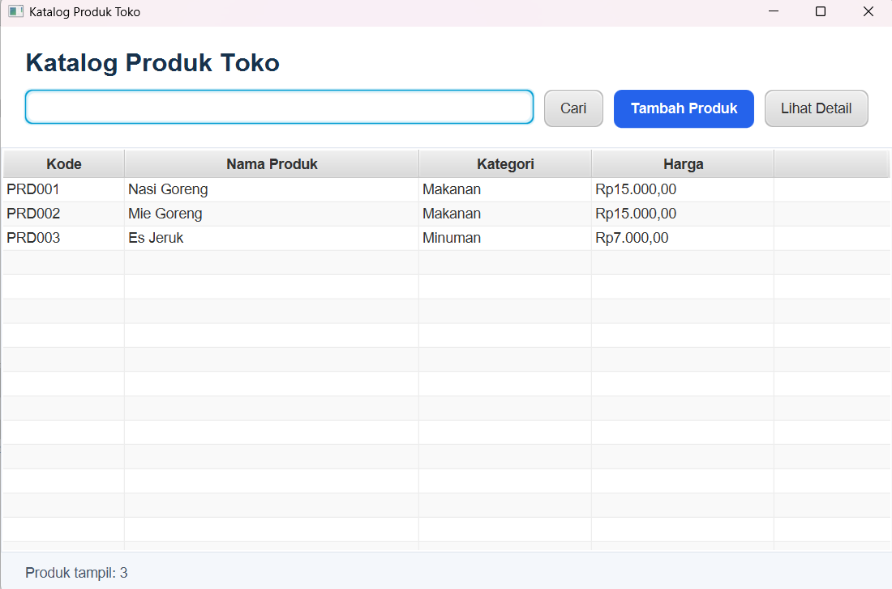
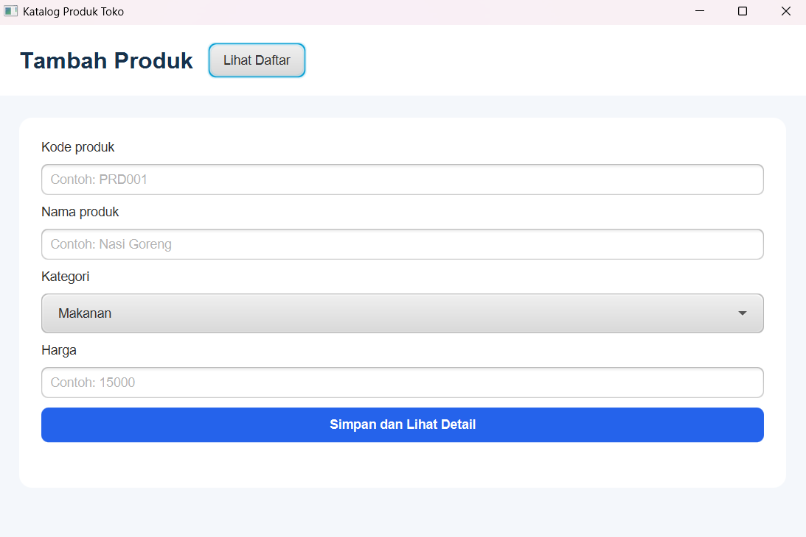
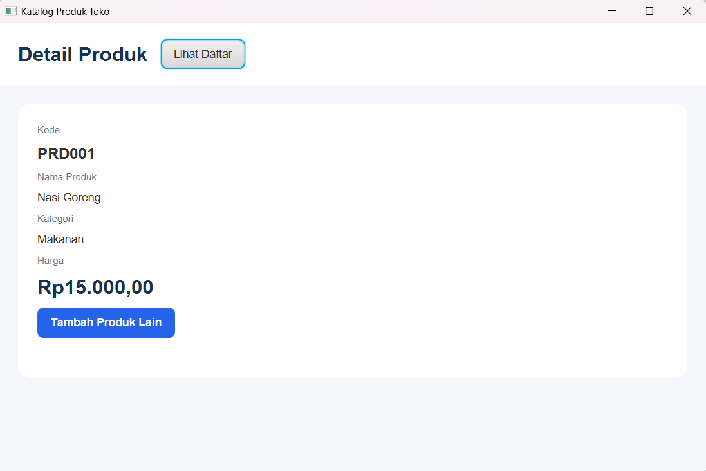
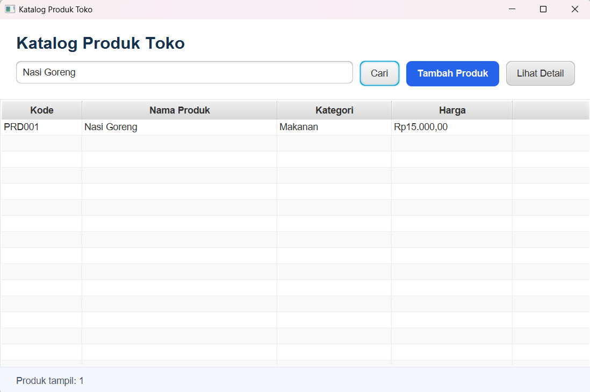

# Katalog Produk Toko

Aplikasi desktop katalog produk toko berbasis JavaFX. Proyek dibuat menggunakan Maven, FXML, CSS, dan dapat diedit menggunakan Scene Builder.

## Fitur

- Menambah data produk
- Data produk terdiri dari kode, nama, kategori, dan harga
- Kategori produk: Makanan atau Minuman
- Validasi nama produk wajib diisi
- Validasi harga harus lebih dari 0
- Menampilkan daftar produk dalam tabel
- Mencari produk berdasarkan nama
- Menampilkan detail produk yang dipilih
- Penyimpanan data sementara di memori

## Teknologi

- Java 17
- JavaFX
- Maven
- FXML
- Scene Builder
- CSS

## Struktur Proyek

```text
src/main/java/kelas/
├── MainApp.java
├── Navigator.java
├── controller/
├── data/
└── model/

src/main/resources/kelas/
├── daftar.fxml
├── form.fxml
├── detail.fxml
└── styles/app.css
```

## Cara Menjalankan

1. Buka proyek menggunakan NetBeans sebagai Maven Project.
2. Pastikan Java Development Kit 17 atau lebih baru tersedia.
3. Klik Run Project atau tekan F6.
4. Aplikasi akan menampilkan halaman katalog produk.

## Screenshot Aplikasi

### Daftar Produk



### Form Tambah Produk



### Detail Produk



### Pencarian Produk

